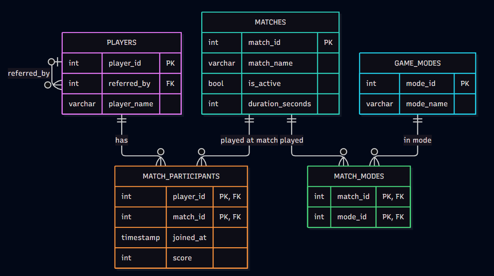

# EX603 Game Telemetry Database

This is a Boston University EX 603 project, maintained by `Aleksei [Keysella] Glebov`.

A relational database design for storing and analyzing player participation and performance across game matches.

**Theme:** Game Telemetry

## Domain

This project models a telemetry platform for a multiplayer game. The platform records players, matches, player participation in those matches, game modes, and numerical performance data. The design is inspired by match-based games such as Teamfight Tactics, although the schema is intentionally general enough to represent similar multiplayer games.

The database should support questions such as which players participated in a particular match, what score a player achieved, which game mode was associated with a match, and how player scores compare across multiple matches. It should also preserve relationships between historical matches, players, and game modes while preventing invalid references or duplicate participation records.

The relational design separates players, matches, participation events, game-mode categories, and match-mode associations so that each fact is stored in one appropriate location.

## Schema

The full DDL is in [schema/schema.sql](schema/schema.sql) (PostgreSQL 14+).
Run it in PostgreSQL Shell:
```
\i schema/schema.sql
```
It runs without errors twice in a row (see [screenshots](<screenshots/Project Assignment 2/>)).

| Table | What it stores |
|---|---|
| players | one row per player; `referred_by` points to the player who invited them |
| game_modes | list of modes (Ranked, Double Up…), names are unique |
| matches | one row per match; active flag and duration |
| match_participants | which player played in which match, when they joined, their score |
| match_modes | which modes a match was played in |

**Design decisions worth noting**
- Junction tables use composite primary keys (player_id, match_id) and (match_id, mode_id) instead of a new id.
- Deleting a match cascades to its participants and modes; deleting a player or a mode that is in use is blocked (RESTRICT).
- `referred_by` is a self-referencing FK; if the referrer is deleted it becomes NULL.
- CHECK constraints: no self-referral, no negative duration, a finished match must have a duration, an active one must not.

Full reasoning: [analysis/unit2.md](analysis/unit2.md).

## Entity Relationship Diagram


