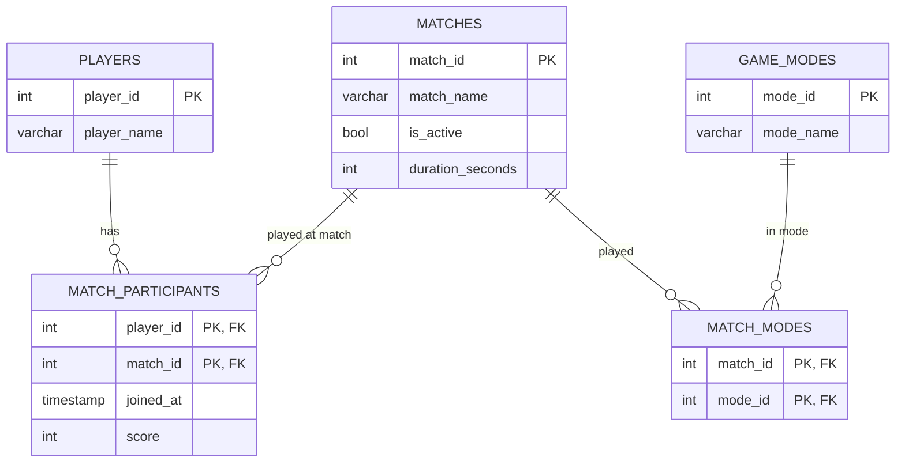

# Relation Schemas for Game Telemetry Database

## Players (Actor)
| type | name | constraints |
|------------|------------|------------|
| int | player_id | PK |
| varchar | player_name | NOT NULL |

Primary key: **player_id**

## Matches (Producer)
| type | name | constraints |
|------------|------------|------------|
| int | match_id | PK |
| varchar | match_name | NOT NULL |
| bool | is_active | NOT NULL |
| int | duration_seconds |  |

Primary key: **match_id**

## Match Participants (Event)
| type | name | constraints |
|------------|------------|------------|
| int | player_id | PK, FK -> Players(player_id) |
| int | match_id | PK, FK -> Matches(match_id) |
| timestamp | joined_at | NOT NULL |
| int | score | NOT NULL |

Primary key: **(player_id, match_id)**

## Game Modes (Catalog)
| type | name | constraints |
|------------|------------|------------|
| int | mode_id | PK |
| varchar | mode_name | NOT NULL |

Primary key: **mode_id**

## Match Modes (Junction)
| type | name | constraints |
|------------|------------|------------|
| int | match_id | PK, FK -> Matches(match_id) |
| int | mode_id | PK, FK -> Game Modes(mode_id) |

Primary key: **(match_id, mode_id)**

## Mermaid  Entity Relationship Diagram
